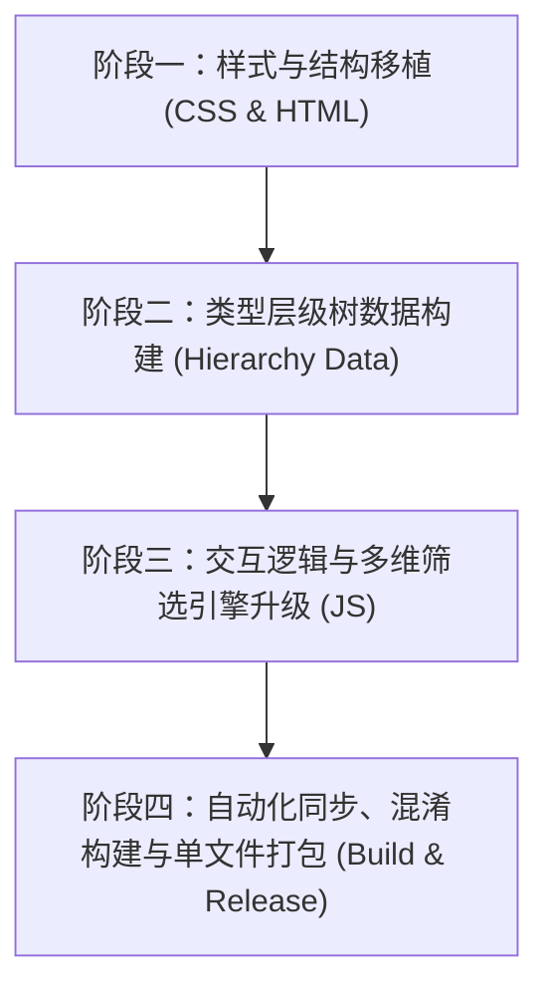

# Median XL 本地云仓库 - 官方同款层级筛选系统改造实施计划 (Plan)

## 一、 项目背景与需求概述
用户反馈现有筛选栏功能略显杂乱（单一下拉框纵向堆叠所有品质、类型和标志），期望改造为 **Median XL 官方仓库系统（The Repository / Global Shop）同款的高颜值、多层级交互筛选栏**。

目标界面特征：
1. **顶层工具栏**：`[Filters ▾]` 主开关（带已激活过滤项数量 Badge）；
2. **二级横向胶囊按钮组**：展开后平铺展示 `[Quality ▾]`、`[Type ▾]`、`[Flags ▾]` 与 `[Ⓧ 清空]`；
3. **`[Type ▾]` 核心弹窗**：
   - 快捷品阶药丸（Tier Chips）：`Sacred`、`Angelic`、`Mastercrafted`、`Tier 1~4`、`No tier` | `Superior`，带实时物品匹配计数；
   - 实时搜索框：`Find a type... (helm, claw, rune)`；
   - 4 层级折叠树（Type Tree）：`Weapons` / `Armors` / `Misc` / `Other`，支持展开/折叠、复选框多选、动态数量角标；
4. **`[Quality ▾]` 弹窗**：包含 `SSSU`、`SSU`、`SU`、`TU`、`Set`、`RW`、`Rare`、`Crafted`、`Magic`、`Normal`、`Superior` 等，带复选框与数量；
5. **`[Flags ▾]` 弹窗**：`Ethereal(无形)`、`Blessed(神圣赐福)`、`Corrupted(腐化)`、`Luckied(幸运)`、`MO'ed(MO强化)` 三态轮转（`any 任意` -> `yes 是` -> `no 否`）；
6. **一键清除按钮 `[Ⓧ]`**：快速重置所有激活的筛选状态。

---

## 二、 详细实施计划

### 阶段一：样式与结构移植（CSS & HTML）
1. **提取与适配官方 CSS**：
   - 从 `TSW — The Repository — Global Shop_files/repository-browser.css` 提取并整合至项目中：
     - `.repository-tag-filter`、`.repository-tag-filter-panel`（胶囊与浮层面板样式、深色主题、阴影与动画）；
     - `.repository-type-tree`、`.rtt-node`、`.rtt-row`、`.rtt-toggle`（树形节点、展开旋转箭头、缩进排版）；
     - `.repository-type-tiers`、`.tier-btn`（快捷品阶药丸按钮、高亮状态与计数 Badge）；
     - `.repository-flag-filter-options`、`.flag-btn`（词缀标志三态样式）；
2. **重构 `index.html` 筛选结构**：
   - 移除现有堆叠式的 `filtersWrap`；
   - 构建 `Filters` 顶层包裹容器，内嵌横向排列的独立 details 弹窗：
     - `#qualityFilterWrap` (`Quality`)
     - `#typeTreeFilterWrap` (`Type`)
     - `#flagFilterWrap` (`Flags`)
     - `#clearFiltersBtn` (`Ⓧ`)

### 阶段二：类型层级树数据构建（Hierarchy Data 与官方汉化对齐）
1. **严格对齐官方 string 文本库（用户重点要求）**：
   - 深入检索 `txt/string.txt`、`txt/expansionstring.txt` 与 `txt/patchstring.txt`；
   - **中英本地化准则**：在树节点、品质项、底材名中，**凡在 string 文本文档中有对应中文的，必须优先使用对应中文；若没有找到对应中文的，则严谨保持官方英文原名**（绝不生硬机翻或乱改名称）。
2. **解析提取官方分类树**：
   - 从 `网页元素.txt` 中全量解析提取 843 个官方分类节点，包括：
     - 一级大类：`weapons`、`armors`、`misc`、`other`
     - 二级分类：`weapons/melee`、`weapons/ranged`、`armors/helms`、`armors/boots`、`misc/runes` 等
     - 三级/四级底材：各个具体部位和装备代号
2. **生成静态数据模块**：
   - 生成 `assets/item_hierarchy.js`，包含树形结构节点及对应的物品底材代码（`codes`）映射表；
   - 保持 100% 本地纯离线运行，无需依赖任何网络请求。

### 阶段三：交互逻辑与多维筛选引擎升级（JS）
1. **类型树交互与联动**：
   - 点击展开/折叠箭头（`▶/▼`）展开分支，并支持 `Collapse` 一键收起全部；
   - 搜索框实时模糊过滤：输入关键字自动高亮并展开匹配的父级节点；
   - 复选框逻辑：勾选父节点自动包含其所有子底材。
2. **品阶药丸（Tier Chips）与 Flags 逻辑**：
   - 快捷品阶药丸点击高亮，支持与类型树条件叠加过滤；
   - Flags 保持原有三态轮转（`全部` -> `是` -> `否`），采用新的小胶囊样式；
3. **动态计数汇总（Facet Counts）**：
   - 载入存档/仓库物品时，遍历当前可视物品集，实时统计每个分类节点、每个品阶药丸、每种品质的物品数量，并渲染到对应的数量 Badge 上；
4. **弹窗互斥与体验优化**：
   - 点击外部区域自动关闭已展开的下拉面板；
   - 打开某一个胶囊时，自动关闭其它已展开的胶囊；
   - 工具栏总 Badge 实时反映当前激活的过滤条件总数。

### 阶段四：自动化同步、混淆构建与单文件打包（Build & Release）
1. 源码完全保留：开发源码（`js/` 目录与 `web/` 目录）保持原汁原味未混淆；
2. 运行 `prepare_dist.js`：自动混淆压缩输出到 `dist/`；
3. 编译发布版：运行 `cargo build --release`，重新生成全新的 `MedianXL-本地云仓库-单文件版.exe` 并同步到发布目录。

---

## 三、 验证与交付标准
1. **视觉一致性**：筛选栏外观与提供的截图完全一致，深色主题、横向胶囊、展开弹窗自然流畅；
2. **筛选准确性**：
   - 点击品质（如 `SSSU`、`SU`）精确筛选；
   - 点击品阶（如 `Sacred`、`Tier 1`）精确筛选；
   - 勾选类型树（如 `Assassin Claws` 或具体某件爪底材）精确匹配；
   - Flags 条件（如 `无形`、`腐化`）正确过滤；
3. **单文件便携性**：编译后的独立版 `.exe` 完全内嵌新功能，独立脱机运行无报错。
